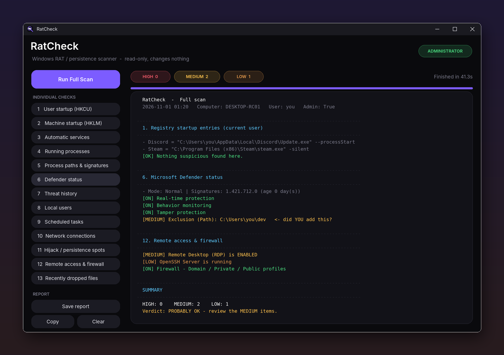

<div align="center">


# RatCheck

**A dark, one-click Windows scanner that checks your PC for signs of a RAT (Remote Access Trojan).**

Read-only · Native .NET 8 · No install needed


[](https://github.com/mellytimes/RatCheck/actions)
[](https://github.com/mellytimes/RatCheck/releases)

</div>

---

## Showcase

<div align="center">

</div>

---

## What is RatCheck?

RATs are malware that let someone else control your PC: watch your screen, steal passwords and Discord tokens, log keys, or use your machine for other attacks. They hide by **starting automatically with Windows**, **disguising themselves as system processes**, and **turning off or blinding your antivirus**.

RatCheck looks in all the places RATs usually hide and gives you a colour-coded report in seconds. It **never changes or deletes anything**. It only reads and reports, so it's safe to run on any PC.

## Features

- 🖤 **Dark UI** with rounded buttons, live HIGH / MEDIUM / LOW counters and a progress bar
- ⚡ **Full scan** in one click, or run any of the **13 checks** on their own
- 🔏 **Real signature checking** through `WinVerifyTrust` plus Windows catalog lookup, so genuine Microsoft files aren't flagged
- 🧵 **Runs on a background thread**, so the window never freezes
- 💾 **Save or copy** the report as plain text to share with a friend or on a forum
- 🛡️ **Administrator by default** so nothing is hidden from the scan
- 🌏 **Works on any Windows language.** Groups are looked up by SID, so it works on Thai, Japanese and other language editions too

## What it checks

| # | Check | What it looks for |
|---|---|---|
| 1 | **User startup** | `HKCU\…\Run`, `RunOnce`, policy Run key and your Startup folder: unsigned files, files in Temp/AppData/Public, scripts launched through PowerShell `-enc`, `mshta`, `wscript`, etc. |
| 2 | **Machine startup** | Same as above for `HKLM`, `WOW6432Node` and the All Users Startup folder |
| 3 | **Automatic services** | Lists non-Microsoft auto-start services and checks the DLL behind `svchost` services |
| 4 | **Running processes** | Fake system names (`svch0st.exe`, `lsass.exe` in the wrong folder), remote-access tools, programs deleted from disk while running, suspicious command lines |
| 5 | **Process paths & signatures** | Every running program's location and digital signature |
| 6 | **Defender status** | Real-time / behaviour / tamper protection, signature age, "disable Defender" policy keys, **exclusions**, and log entries showing protection was turned off |
| 7 | **Threat history** | Past Defender detections. Known RAT and stealer families (Remcos, AsyncRAT, njRAT, Quasar, RedLine, Lumma…) are raised to HIGH |
| 8 | **Local users** | Enabled Guest or built-in Admin, `$`-hidden accounts, recently created accounts, unexpected administrators |
| 9 | **Scheduled tasks** | Non-Microsoft tasks, plus tasks hidden by deleting their security descriptor |
| 10 | **Network connections** | Unsigned programs from user folders that are online, and ports commonly used by RATs |
| 11 | **Hijack spots** | Winlogon `Shell`/`Userinit`, IFEO debuggers, `AppInit_DLLs`, WMI event subscriptions, hosts file, system proxy |
| 12 | **Remote access & firewall** | RDP, Remote Assistance, OpenSSH, WinRM, firewall profiles, inbound rules for unsigned programs |
| 13 | **Recently dropped files** | Unsigned `.exe` `.dll` `.scr` `.vbs` `.js` `.hta` `.bat` `.ps1` files created in the last 7 days in Temp / AppData / Public / ProgramData |

## Reading the results

| Level | Meaning | What to do |
|---|---|---|
| 🔴 **HIGH** | Strong sign of malware or tampering | Investigate before trusting the PC |
| 🟡 **MEDIUM** | Could be malicious, often something you set up yourself | Ask yourself: *"did I do this?"* |
| 🟠 **LOW** | Usually harmless, worth knowing about | Glance and move on |
| 🟢 **OK / ON** | Clean or protection is enabled | Nothing to do |

**Common MEDIUM items that are usually fine:** Defender exclusions you added for WSL or dev folders, AnyDesk / Parsec / TeamViewer you installed yourself, Remote Desktop you turned on, Docker entries in the hosts file.

**If you get HIGH items that you can't explain:**

1. Disconnect the PC from the internet.
2. Run a **Microsoft Defender Offline scan** (Windows Security → Virus & threat protection → Scan options).
3. Change your important passwords **from a different device** (Discord, Google, Steam, banking) and log out of all sessions.
4. Get a second opinion with [Sysinternals Autoruns](https://learn.microsoft.com/sysinternals/downloads/autoruns) and [Process Explorer](https://learn.microsoft.com/sysinternals/downloads/process-explorer), with VirusTotal checking turned on.

## Download

Grab `RatCheck.exe` from the [**Releases**](https://github.com/mellytimes/RatCheck/releases) page, double-click it and accept the UAC prompt.

### "Windows protected your PC"?

RatCheck isn't code-signed yet, and Windows SmartScreen warns about **every** new unsigned program until enough people have run it. Click **More info → Run anyway**.

If you'd rather not trust a stranger's .exe (fair, it's a security tool), you have two options:

- Read the source and [build it yourself](#build-from-source). It's one command.
- Check that the release exe really came from this repo (see below).

### Verify your download

Every release is **built automatically by [GitHub Actions](../../actions)** from the public source code. Nothing is built or uploaded by hand.

- **SHA-256:** each release lists the hash and includes a `RatCheck.exe.sha256` file. Check it with:
  ```powershell
  Get-FileHash .\RatCheck.exe -Algorithm SHA256
  ```
- **Build provenance:** with the [GitHub CLI](https://cli.github.com/) you can prove the exe was built by this repo's workflow:
  ```powershell
  gh attestation verify .\RatCheck.exe -R mellytimes/RatCheck
  ```
- **VirusTotal:** each release links its VirusTotal scan in the release notes.

## Build from source

**Requirements:** Windows 10/11 x64 and the [.NET 8 SDK](https://dotnet.microsoft.com/download/dotnet/8.0)

```powershell
winget install Microsoft.DotNet.SDK.8      # one time, then reopen the terminal
git clone https://github.com/mellytimes/RatCheck.git
cd RatCheck
```

**Self-contained single file** (about 150 MB, runs anywhere, no .NET needed):

```powershell
dotnet publish -c Release -r win-x64 --self-contained true -p:PublishSingleFile=true -p:IncludeNativeLibrariesForSelfExtract=true -o publish
```

**Small single file** (about 1 MB, needs the [.NET 8 Desktop Runtime](https://dotnet.microsoft.com/download/dotnet/8.0) installed):

```powershell
dotnet publish -c Release -r win-x64 --self-contained false -p:PublishSingleFile=true -o publish
```

The result is `publish\RatCheck.exe`.

> **Note:** the app manifest requires Administrator. When using `dotnet run` or Visual Studio, start the terminal or IDE **as Administrator**, otherwise Windows refuses to launch it.

## Project structure

```
RatCheck/
├── Program.cs        Entry point
├── MainForm.cs       Window: sidebar, report panel, counters, progress, save/copy
├── Theme.cs          Colours + custom rounded controls (buttons, pills, card, progress line)
├── Scanner.cs        All 13 checks and the summary
├── Helpers.cs        Signatures (WinVerifyTrust + catalog), path rules, registry & WMI helpers
├── app.manifest      Requests Administrator, Windows 10/11 compatibility
├── icon.ico          App icon
├── docs/             README images
└── .github/workflows/build.yml   Builds every push; publishes a Release for every v* tag
```

## Limitations

RatCheck is a **heuristic triage tool**, not an antivirus.

- A well-made RAT or rootkit running with high privileges **can hide from any tool running on the same machine**. For certainty, scan offline.
- It flags *signs* of compromise. A finding is a reason to look closer, not proof of infection, and a clean result is not a guarantee.
- It doesn't remove anything. Use Windows Security or another antivirus to clean up.

## Contributing

Issues and pull requests are welcome, especially new detection ideas, false-positive reports (include the report line), and translations.

## License

[MIT](LICENSE) © 2026 mellytimes
